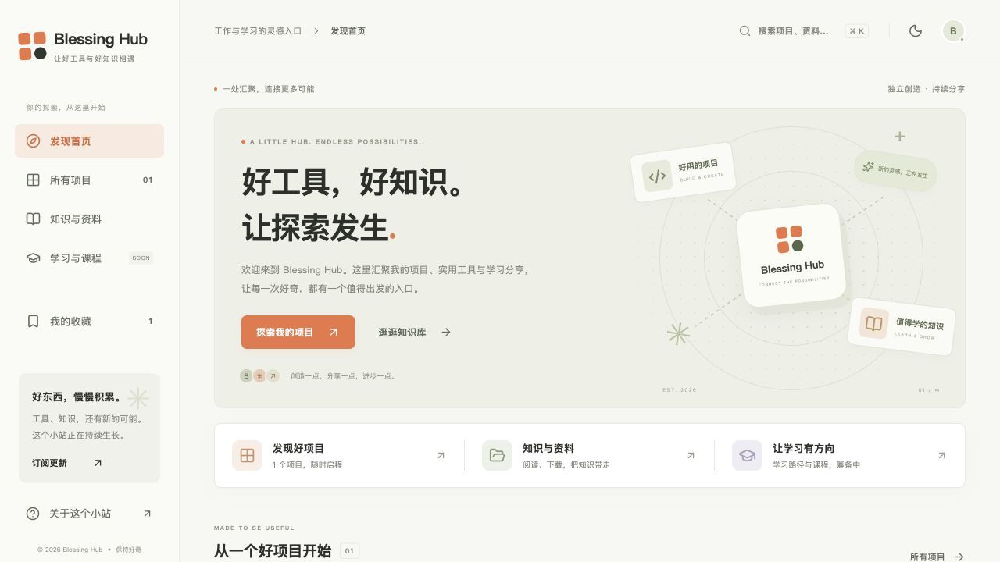

# Blessing Hub

项目、工具、学习资料与未来课程的聚合入口。代码和构建在本机完成，生产静态文件由现有服务器上的 Nginx 提供，不需要额外常驻 Node 服务。

生产域名：[blessingshs.cc.cd](https://blessingshs.cc.cd/)

代码仓库：[shs928/blessingHub](https://github.com/shs928/blessingHub)



## 本地使用

需要 Node.js 22.12+（或符合当前 Vite 版本要求的更新版本）。

```bash
npm ci
npm run dev
```

默认预览地址以终端输出为准。生产构建与预览：

```bash
npm run build
npm run preview
```

## 当前功能

- 首页、项目导航、项目详情与分类检索
- 全站搜索，支持 `⌘ K` / `Ctrl K`、方向键、回车和 Esc
- 浏览器本地收藏与深浅主题；不需要登录，不跨设备同步
- 资料分类、独立文章、真实 Markdown 文件下载
- 明确标注为筹备中的学习方向与课程
- 更新日志、真实 RSS 订阅源
- 手机端侧栏导航、响应式布局与减少动画偏好
- 为每个公开页面生成完整 HTML、独立标题、描述、canonical 与 sitemap
- 独立 404 页面；未知地址在生产环境返回 HTTP 404

## 维护内容

主要修改 `src/content.json`：

| 字段        | 用途                                 |
| ----------- | ------------------------------------ |
| `site`      | 名称、正式域名、发布日期             |
| `projects`  | 项目名称、地址、分类、标签与介绍     |
| `resources` | 资料、文章分节与可选下载链接         |
| `plans`     | 尚未发布的学习方向；不能当成已售课程 |
| `updates`   | 首页动态、更新记录与 RSS 条目        |

首页、导航数量、分类、搜索和订阅源从同一份内容生成。新项目使用唯一 `id`，提供完整 HTTPS 地址；将 `featured` 设置为 `true` 可显示在首页。

下载文件放入 `public/downloads/`，在资料的 `download` 字段填写 `/downloads/文件名`。新增文章会自动生成 `/resources/<id>/index.html`。

站点样式位于 `src/styles.css`，主要界面在 `src/main.tsx`。`scripts/prerender.mjs` 生成页面，`scripts/generate-feeds.mjs` 生成 RSS。

## 服务器部署

服务器：`119.45.123.248`。本项目不保存 SSH 密码或 Cloudflare 凭据；通过终端提示输入密码，或使用自己配置的 SSH 密钥。

```bash
bash scripts/deploy.sh
```

默认使用 `root@119.45.123.248`。可用 `BLESSING_DEPLOY_HOST` 修改目标。已有 SSH 复用连接时，可通过 `BLESSING_SSH_CONTROL_PATH` 指定 socket 路径。

部署脚本会完成构建、上传到新的版本目录、备份 Hub 自身的 Nginx 配置、验证 Nginx、切换软链接并平滑重载。验证失败会恢复之前的链接和 Hub 配置。现有 `sub2api.conf` 不在本脚本的修改范围内。

生产目录：

```text
/var/www/blessing-hub/releases/<UTC版本时间>/
/var/www/blessing-hub/current -> 当前版本
/var/www/blessing-hub/backups/
/var/www/blessing-hub/previous-release  # 有前一成功版本时生成
/etc/nginx/conf.d/blessing-hub.conf
```

Nginx 模板在 `deploy/nginx.conf`。站点同时接收 80、443、8443，兼容当前 Cloudflare 回源配置；根据 Host 将主站和现有 API 服务分开。

需要手动恢复旧静态版本时，在服务器上查看 `previous-release` 并执行：

```bash
previous_release="$(cat /var/www/blessing-hub/previous-release)"
test -d "$previous_release"
ln -sfn "$previous_release" /var/www/blessing-hub/rollback-link
mv -Tf /var/www/blessing-hub/rollback-link /var/www/blessing-hub/current
nginx -t
systemctl reload nginx
```

## 域名与 Cloudflare

Cloudflare 中的主域名 A 记录已配置为 `119.45.123.248`，并开启代理。生产 HTTPS 使用 8443 回源，保留当前 Full 加密模式；主站和现有 API 已通过公网 HTTPS 检查。

主域名的独立回源规则已在控制台部署，配置如下：

| 项目         | 设置                                         |
| ------------ | -------------------------------------------- |
| DNS          | A `@` → `119.45.123.248`，已代理             |
| SSL/TLS 模式 | Full（完全），已在控制台确认                 |
| 规则匹配     | `(http.host eq "blessingshs.cc.cd" and ssl)` |
| 目标端口     | `8443`                                       |

- 回源规则仅匹配主域名，现有 API 的规则保持独立。
- `www` 尚未配置 DNS；如果需要，可添加指向主域名的代理 CNAME。
- 现有源站使用自签名证书，当前模板沿用现有 **Full** 模式。切换 **Full (strict)** 前，需要先安装覆盖主域名的有效证书或 Cloudflare Origin Certificate。
- 回源规则名称：`Blessing Hub HTTPS origin 8443`。修改相关配置后，应验证 HTTPS 首页、文章、下载、RSS 和原 API 子域名。

## 后续扩展

当前是可上线的内容与导航首版。随着项目和资料增长，可逐步增加内容管理后台、数据库与对象存储。课程体系、用户账户、订单、支付和受限下载应在真实业务内容明确后接入；目前没有对应的后端服务。
